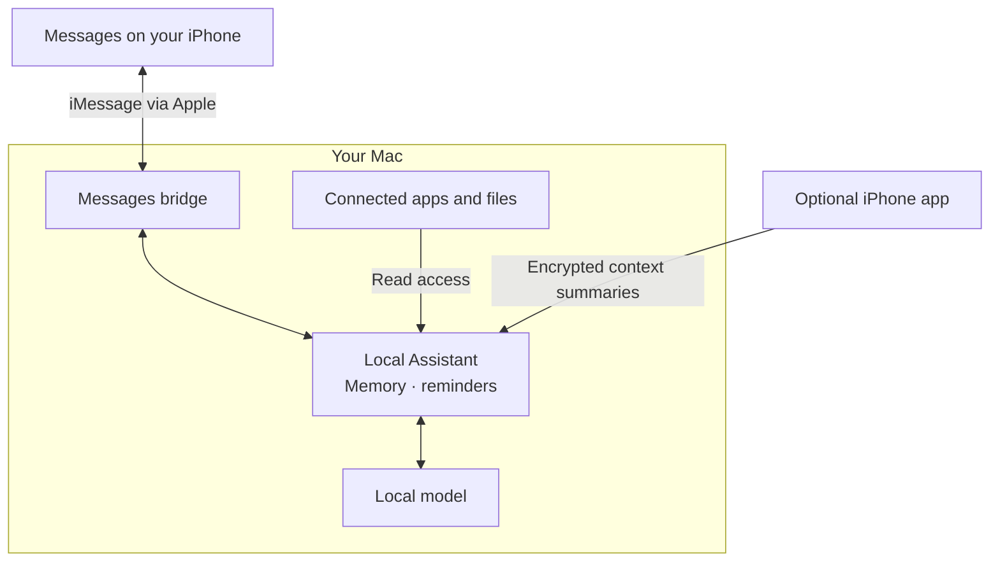

# Local Assistant

**On-prem proactive AI assistant**

Text your own number. Your Mac answers using the apps and files you connect,
with a model running on your Mac.

- Ask about your calendar, messages, notes and email.
- Find information in your files and continue with follow-up questions.
- Turn on a daily reminder for upcoming commitments.

## How it works



The model and saved memory stay on your devices. Messages uses Apple's delivery service.
The optional iPhone app shares the context you enable and has its own local conversation.

## Get started

On your Mac, choose **Code → Download ZIP**, unzip it, and open Terminal in that folder:

```bash
bash scripts/start.sh
```

Setup helps you choose a model, connect Messages and approve source access.
Then send `/status` to your self-chat and try “What's on my calendar tomorrow?”

For the menu bar app, stop the Terminal assistant and run:

```bash
bash scripts/install-mac-app.sh
```

Use `/resume` to enable proactive reminders and `/pause` to pause them.

[Setup](docs/install.md) · [Use](docs/use.md) · [Privacy](PRIVACY.md)
